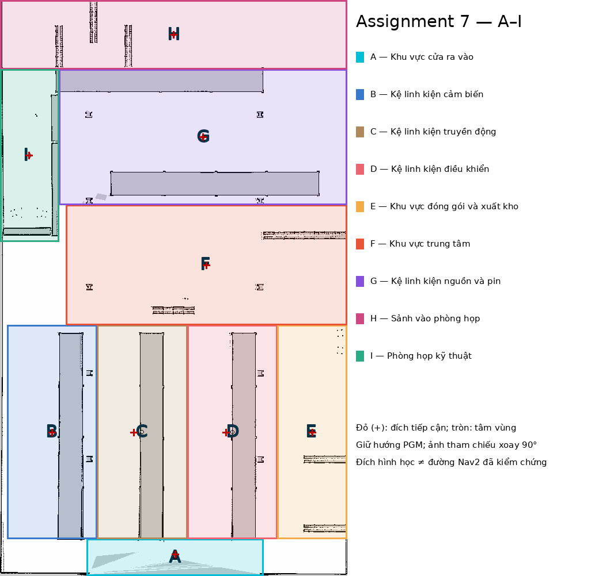

# Assignment 7 — Điều hướng TurtleBot 4 bằng giọng nói

## 1. Giới thiệu

Nhận lệnh tiếng Việt bằng micro và Whisper `small` đa ngôn ngữ (CPU INT8), sau đó điều hướng
qua Nav2 đến chín vùng A–I trong kho. Giữ nguyên chức năng bài 4–6.
Repository: [UR_HRI_assignments](https://github.com/uonggiahuy/UR_HRI_assignments),
nhánh `assignments_7`.

**Bản đồ kho đã chia vùng A–I:**



| Khu vực | Chú thích |
| --- | --- |
| A | Khu vực cửa ra vào |
| B | Kệ linh kiện cảm biến |
| C | Kệ linh kiện truyền động |
| D | Kệ linh kiện điều khiển |
| E | Khu vực đóng gói và xuất kho |
| F | Khu vực trung tâm |
| G | Kệ linh kiện nguồn và pin |
| H | Sảnh vào phòng họp |
| I | Phòng họp kỹ thuật |

Màu và chữ A–I trên ảnh tương ứng với bảng trên. Dấu cộng đỏ (+) là đích
điều hướng tiếp cận; vòng tròn là tâm vùng. Đích trên bản đồ không bảo đảm
đường đi luôn thông thoáng; Nav2 kiểm tra đường đi và vật cản khi chạy.

## 2. Cài đặt và build

Chạy trong container ROS 2 Humble / Ubuntu 22.04 đã có các dependency của dự án.
Từ host, mở mỗi terminal bằng `docker exec -it ros_humble_env bash`.

```bash
cd /root/ros2_ws
source /opt/ros/humble/setup.bash
bash src/turtlebot4/scripts/prepare_assignment7_runtime.sh
colcon build --symlink-install --packages-select turtlebot4
source install/setup.bash
```

Script cài môi trường Whisper riêng; lần đầu tải model cần mạng. Container cần
kết nối micro của host. Trong **mỗi terminal mới**, chạy:

```bash
cd /root/ros2_ws
source /opt/ros/humble/setup.bash
source install/setup.bash
source src/turtlebot4/scripts/simulation_environment.bash
```

## 3. Cách chạy

Script môi trường giới hạn Ignition và Cyclone DDS vào loopback cho mô phỏng
trên cùng máy, tránh lỗi discovery khi có Wi-Fi/VPN/nhiều card mạng. Chạy trong
**mọi terminal mô phỏng**, kể cả RViz và Assignment 7; không dùng cho robot thật
hoặc ROS phân tán. Giữ nguyên `IGN_IP`/`CYCLONEDDS_URI` nếu đã đặt riêng; khi
chẩn đoán cấu hình cũ, mở shell mới và kiểm tra hai biến này. NVIDIA, webcam,
micro và môi trường Whisper không bị thay đổi.

**Terminal 1 — Gazebo**, giữ chạy:

```bash
ros2 launch turtlebot4 turtlebot4.launch.py world:=warehouse model:=standard rviz:=false
```

**Terminal 2 — Map Server và AMCL**, giữ chạy:

```bash
ros2 run turtlebot4 start_localization
```

**Terminal 3 — RViz**, giữ chạy:

```bash
rviz2 -d "$(ros2 pkg prefix turtlebot4)/share/turtlebot4/rviz/assignment7.rviz" \
  --ros-args -r __node:=assignment7_rviz -p use_sim_time:=true
```

Trước khi mở RViz, nếu robot còn dock, kiểm tra phía sau trống rồi chạy một lần:

```bash
ros2 action send_goal /undock irobot_create_msgs/action/Undock '{}' --feedback
ros2 topic echo /dock_status --once
```

Đợi undock `SUCCEEDED`, dock status `false`. Trong RViz chọn **2D Pose Estimate**,
đặt đúng vị trí và hướng **hiện tại**; kiểm tra LiDAR khớp map. Không mở thêm
RViz trùng lặp. Sau mỗi lần restart Gazebo phải định vị lại trong cùng world.

**Terminal 4 — kiểm tra định vị rồi chạy Nav2**, giữ lệnh cuối chạy:

```bash
ros2 run turtlebot4 prepare_navigation --timeout 45
ros2 run turtlebot4 check_localization --timeout 20 --json
ros2 run turtlebot4 start_navigation --timeout 45
```

Chỉ tiếp tục khi kiểm tra thành công. Dừng teleop, gesture và waypoint trước
khi dùng giọng nói; không chạy SLAM cùng AMCL.

**Terminal 5 — Assignment 7**, giữ chạy trong terminal tương tác:

```bash
ros2 launch turtlebot4 assignment7.launch.py
```

## 4. Sử dụng giọng nói

1. Đợi `Microphone: READY` và `Status: WAITING FOR INPUT` ở Terminal 5.
2. Nhấn **Enter** để bắt đầu ghi âm.
3. Nói một lệnh tiếng Việt.
4. Nhấn **Enter** lần nữa để dừng và gửi toàn bộ đoạn âm thanh cho Whisper.
5. Đợi `[WHISPER] Recognized: ...` và `[ROS] Published: /recognized_speech`.
6. Quan sát robot và `/assignment7/state`; đợi nhiệm vụ hoàn thành trước lệnh mới.
7. Khi thấy `[READY]`, có thể ghi câu tiếp theo. Enter trong lúc nhận dạng bị bỏ qua.

Ví dụ: “Đi đến khu vực F”, “Đi đến khu nguồn”, “Đi đến phòng họp”,
“Đi từ khu G đến khu H”, “Dừng lại”. Lệnh hủy được nhận cả khi đang điều hướng.
Giới hạn mặc định 30 giây; đoạn quá dài, rỗng hoặc im lặng bị loại.
Có thể chọn micro và giới hạn khi launch:

```bash
ros2 launch turtlebot4 assignment7.launch.py microphone_device:=0 max_recording_duration:=20.0
```

Model mặc định `small` đã nhận đúng câu “Đi đến khu vực F” khi thử micro;
chưa nghiệm thu điều hướng bằng giọng nói với Nav2. Nếu cần model nhẹ hơn,
thêm `whisper_model:=base` vào lệnh launch.

Micro chỉ mở khi bắt đầu ghi; trạng thái chờ giữa các câu không hủy nhiệm vụ.

## 5. Kiểm tra và xử lý lỗi

Liệt kê micro và kiểm tra runtime (một lần):

```bash
bash src/turtlebot4/scripts/prepare_assignment7_runtime.sh
```

Quan sát bằng terminal phụ:

```bash
ros2 topic echo /recognized_speech
ros2 topic echo /assignment7/state
```

Không có micro: kiểm tra kết nối audio host/container. Không thấy transcript:
xem số mẫu, peak/RMS và lý do lỗi `[AUDIO]`/`[WHISPER]` ở Terminal 5.
Lỗi terminal tương tác: dùng `docker exec -it`, không chạy launch qua pipe/nền.
Chỉ kiểm thử văn bản ngoại tuyến, không mở micro hoặc chờ Enter:

```bash
ros2 launch turtlebot4 assignment7.launch.py test_mode:=offline speech_enabled:=false
```

Dừng an toàn: nói “Dừng lại”, đợi `CANCELED` và robot đứng yên; Ctrl+C Terminal 5,
rồi Terminal 4, 2, 3 và cuối cùng 1. Nếu nhận dạng lỗi khi robot đang chạy,
Ctrl+C Terminal 5 để yêu cầu hủy nhiệm vụ; xác nhận robot dừng.
