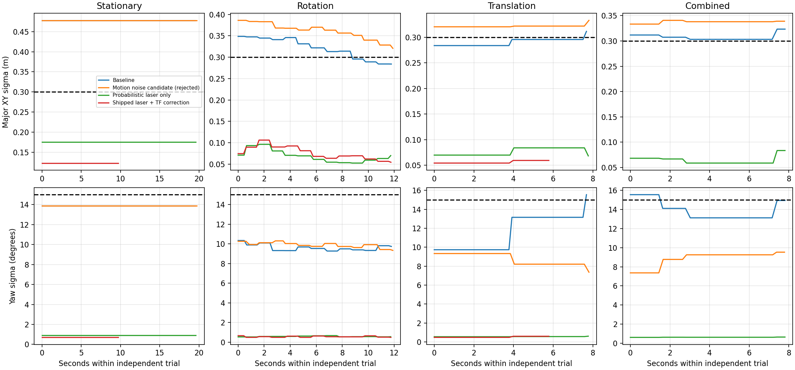
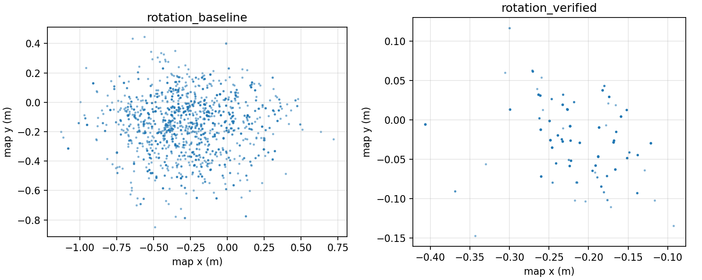
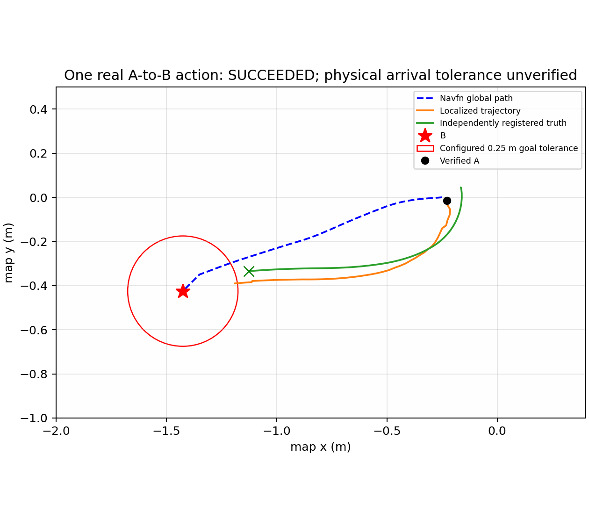

# M4.3 — AMCL convergence, independent registration and one A-to-B navigation action

Date: 2026-10-13 (Asia/Bangkok). Branch: `assignments_4`. Baseline: `8d2820b`.

**Overall acceptance: FAIL / physical arrival tolerance NOT VERIFIED.** The user's
updated acceptance requires **one** meaningful A-to-B goal, replacing the earlier
three-goal requirement. One real `NavigateToPose` action **SUCCEEDED** after all
localization gates passed. The robot moved 1.034 m, had zero recoveries, no recorded
bumper contacts or prohibited hazards, and stopped. Nav2's final errors were
0.239 m / 0.246 rad, within the unchanged 0.25 m / 0.25 rad tolerances.

Independently registered physical arrival residual was **0.312 m**, exceeding the
nominal position tolerance. Reference uncertainty is 0.15 m; the resulting
position-error interval is approximately [0.162, 0.462] m. Physical arrival inside
the configured tolerance cannot be certified. No additional goal was sent to
hide this result. Localization convergence and this autonomous execution are
verified improvements; complete physical navigation acceptance remains incomplete.
M5/M6 were not implemented.

## Scope, environment and preserved baseline

Read AGENTS.md, the platform/simulation/localization/Nav2/debugging/demo and ROS
debugging skills, M0/M1/upstream and M3.5–M4.2 reports, runners, diagnostics,
initial-pose CLI, verifier, YAML, RViz and README. The newer user instruction
overrides three-goal examples in AGENTS/skills for M4.3; those files were not edited.

Current environment: Ubuntu 22.04.5 container, ROS Humble, CycloneDDS, DISPLAY=:1.
The existing TF2 0.25.24 overlay was explicitly sourced after the assignment
overlay. AMCL/RViz loaded-library observations are in `runtime_libraries.txt`.
No host Docker/9Router, UR, upstream package or installed TF2 configuration changed.
Initially no simulation/localization/navigation process was active. All subsequent
launches were task-owned foreground processes, with bounded deadlines.

The original 168 tests remain, with 27 added cases: **195 tests PASS**, targeted
build PASS, colcon **0 errors, 0 failures, 0 skipped**. Original user map changes
remain uncommitted and were never staged, saved, replaced, regenerated or reverted.
The retained-map startup correction and original M1 launch behavior remain intact.

M4.2 left high posterior uncertainty, unverified world/map registration, and
unreproduced DWB/path/recovery defects. Fresh TF was correctly distinguished from
convergence. This task addresses AMCL first; it does not assume all old symptoms
share one cause.

## Actual AMCL parameter and source audit

`parameters_baseline.yaml`, candidate dumps, `parameters_verified.yaml` and
`parameters_a_to_b.yaml` came from native parameter services. Names below are the
actual Humble names (`max_beams`, `z_hit`, `sigma_hit`, `z_rand`), rather than
invented `laser_*` aliases. Installed AMCL was Nav2 1.1.20.

| Parameters | Baseline / shipped | Mechanism and measured interpretation |
| --- | --- | --- |
| min/max_particles | 500 / 2000, unchanged | KLD sampling limits; broad baseline cloud reached 2000, corrected cloud about 501. No count reduction forced convergence. |
| pf_err / pf_z | .05 / .99, unchanged | KLD approximation parameters; no evidence requiring a change. |
| update_min_d / update_min_a | .25 m / .2 rad, unchanged | Motion triggers measurement updates. Stationary scans alone do not repeatedly update the posterior. |
| resample_interval | 1, unchanged | Resampling on measurement updates, not every received stationary scan. |
| recovery_alpha_fast / slow | 0 / 0, unchanged | Adaptive random-particle recovery disabled upstream; no unexplained injection added. |
| laser_model_type | likelihood_field → likelihood_field_prob | Standard additive beam scoring preserved a broad posterior; product likelihood separated plausible hypotheses more strongly. Physical and scan agreement were independently checked. |
| max_beams / sigma_hit | 60 / .2 m, unchanged | Subsampling and hit width retained; no artificially sharp sensor noise. |
| z_hit / z_rand | .5 / .5, unchanged | Mixture weights retained. z_short=.05, z_max=.05, lambda_short=.1 also retained. |
| laser_likelihood_max_dist | 2 m, unchanged | Distance-field range retained; no obstacle inflation modification. |
| laser_min/max_range | -1 / 100 m, unchanged | Actual scan limits .164–12 m constrain usable endpoints. These configured values do not make a 100 m sensor. |
| robot_model_type | nav2_amcl::DifferentialMotionModel, unchanged | Matches the differential base. Measured rotation slip makes zero-noise odometry unjustified. |
| alpha1–alpha5 | all .2, unchanged | A lower alpha2/alpha3 candidate did not recover positional convergence and was rejected. |
| transform_tolerance | 1.0 → .2 s | AMCL post-dates corrections; long interpolation lag during rotation produced measured scan/map disagreement. Shorter post-dating improved exact-scan-time alignment without weakening freshness checks. |
| tf_broadcast / frames | true; map / odom / base_link, unchanged | AMCL remains sole live map→odom authority; SLAM absent. |
| scan_topic / use_sim_time | scan / true, unchanged | Real LiDAR and advancing simulation time verified. |
| beam skipping | false, unchanged | No obstacle/beam rejection shortcut enabled. |

Pinned upstream implementations inspected:
[AMCL update/TF publication](https://github.com/ros-navigation/navigation2/blob/1.1.20/nav2_amcl/src/amcl_node.cpp),
[additive likelihood field](https://github.com/ros-navigation/navigation2/blob/1.1.20/nav2_amcl/src/sensors/laser/likelihood_field_model.cpp),
[probabilistic likelihood field](https://github.com/ros-navigation/navigation2/blob/1.1.20/nav2_amcl/src/sensors/laser/likelihood_field_model_prob.cpp),
[differential model](https://github.com/ros-navigation/navigation2/blob/1.1.20/nav2_amcl/src/motion_model/differential_motion_model.cpp).
The additive implementation accumulates beam scores; the probabilistic variant
accumulates log likelihoods. Source behavior supports the measured mechanism;
it does not prove that one laser model is universally preferable.

Only those two AMCL parameter values differ from upstream in assignment-owned
`config/localization.yaml`. The initial covariance remains x/y variance .25 m²
and yaw variance (15°)². No uncertainty was rewritten. Unused upstream map-saver
entries in this config do not alter the saved map or invoke a saver.

## LiDAR, odometry, TF and clock

Actual scan frame: `turtlebot4/rplidar_link/rplidar`. Measured base←laser extrinsic:
translation [-.04, 0, .192915] m, yaw +π/2. The installed RPLIDAR xacro specifies
640 rays and 62 Hz; endpoint calculations apply the actual 90° mounting rotation.
Odom frame/child: `odom` / `base_link`; simulator reference frame: `warehouse`.
There was no fabricated world/map TF or pose teleportation.

Baseline 12 s rotation: odom angular change about 2.360 rad, true world change
2.217 rad (approximately 6% slip), negligible translation. Baseline 8 s translation:
world 0.62591974 m versus odom 0.62592 m. Final-config 6 s translation:
world 0.47399980 m versus odom 0.474 m. Linear scale agrees; angular slip remains
real and is not erased by changing noise parameters or overwriting odometry.

Fresh scan/odom/truth/clock and advancing TF were observed. Early moving-trial
endpoint comparisons used latest TF; those raw measurements are preserved but
superseded for precise dynamic scan alignment. A first exact-time attempt stopped
on a 6 ms asynchronous TF-delivery gap. The final observer buffers recent scans
and uses a scan no older than .1 s whose exact acquisition-time transform exists.
No latest-transform fallback is substituted for exact-time geometry.

## Controlled convergence experiments and ambiguity

All motion trials ran without Nav2/SLAM/teleop, required undocked state, actual
scan clearance >.5 m, fresh supporting data, and no prohibited hazard. Translation
preflight checked the whole swept centerline at mapped clearance >.45 m. The
first proposed longer baseline translation failed clearance preflight before
movement; the shorter 8 s experiment was chosen from measured available space.
Commands were at most .08 m/s and .20 rad/s. Repeated zeros and stopped odometry
were checked afterward. Hazard 0 BACKUP_LIMIT was observed and never bypassed.

| Trial | Final XY major sigma (m) | Yaw sigma (rad) | Sampled AMCL updates | Final-reference full-window convergence |
| --- | --- | --- | --- | --- |
| Baseline stationary, 20 s | .4781 | .2422 | 1 | FAIL |
| Baseline rotation, 12 s | .2839 | .1699 | 13 | FAIL |
| Baseline translation, 8 s | .3117 | .2713 | 3 | FAIL |
| Baseline combined, 8 s | .3233 | .2608 | 4 | FAIL |
| Lower motion-noise rotation | .3206 | .1629 | 13 | FAIL — rejected |
| Lower motion-noise translation | .3332 | .1285 | 3 | FAIL — rejected |
| Probabilistic laser stationary | .1755 | .0160 | 1 | PASS in this candidate trial only |
| Exact-time rotation, laser + .2 s TF | .1113 | .0099 | 12 | PASS |
| Shipped config restart, stationary | .1231 | .0122 | 1 | FAIL — physically biased hypothesis |
| Shipped config restart, rotation | .0543 | .0084 | 13 | PASS |
| Shipped config restart, translation | .0595 | .0105 | 2 | PASS |
| Shipped config restart, 10 s stop | .0595 | .0105 | 1 | PASS |
| Final A→B session, rotation | .0464 | .0103 | 13 | PASS |
| Final A→B session, 10 s stop | .0464 | .0103 | 1 | PASS |

Counts are sampled unique output stamps, including the initially retained pose,
not a guarantee of every internal filter update. Stationary covariance remained
unchanged despite fresh scans/TF. Post-translation retained pose can also precede
the last sub-threshold displacement. In the earlier verified session this honestly
failed pose/TF agreement; one discovered `/request_nomotion_update` service call
while stopped acquired the pending real scan. No repeated update loop was used.
The final A→B session passed retained-stationary policy without that call.



The laser-only candidate improved uncertainty but exact-time moving geometry
still fell to about .941 of endpoints within .15 m. With .2 s post-dating, the
same rotation reached a minimum fraction about .986 and maximum p90/p95 .10 m.
No update threshold, critic, obstacle setting or readiness threshold was loosened.



Baseline rotation cloud: 1524 particles, major sigma .284 m; translation reached
2000 particles and .312 m sigma. Corrected restart rotation: about 501 particles,
.054 m sigma. Published weights were approximately uniform after resampling;
their effective count is **post-resampling**, and pre-resampling ESS is not
observable from this topic. A stationary subscriber may miss the volatile cloud
published before subscription; missing cloud is reported as unavailable.

Parallel repeated shelves plausibly weaken translational observability. The most
important counterexample is a repeatable stationary estimate with sigma .123 m
but physical residual .265 m. Small covariance and good nearest-obstacle scan
agreement therefore cannot certify the correct position. Bounded rotation plus
undock disambiguated this local hypothesis. Broad clouds and this biased compact
hypothesis support ambiguity; they do not demonstrate a specific globally separated
multi-aisle mode or prove SLAM drift. Density metrics and raw particle samples are
retained in `particle_metrics.json` and trial files.
The major-axis histogram heuristic counted one peak in the broad baseline cloud
and two in the narrow corrected cloud. Those local histogram peaks do not prove
two globally distinct shelf-aisle hypotheses or invalidate the measured reference
gate; they caution against treating particle count or a single shape statistic as
accuracy evidence.

## Independent simulator-to-map reference

YAML origin is grid metadata. The original SLAM map-frame history remains unknown.
AMCL estimates were not used to fit registration.

The M4.2 collision-box/extrema fit had maximum residual .191 m. A new robust
extrema candidate still exceeded .21 m and remained unverified. The stronger
method reads the actual cached Fuel shelf COLLADA mesh, applies node transforms,
link x offset -.5 and visual rotation π/2, and intersects sensor-visible geometry
near laser height z=.19 m. Its slice bounds differ from the simplified collision
box: local x approximately [-1.57,.57], y [-9.03,9.03]. Source SDF/mesh SHA-256
values are in `geometry_provenance.json`.

Two independently associated outside southern shelf groups are fitted to occupied
map-cell distance; the central shelf is held out. Bounded deterministic SE(2)
optimization uses seed 5 and no AMCL input. Transform map←warehouse:
translation **(.18730248,.04360042) m**, yaw **-.00255863 rad**.

| Validation | Points | Median (m) | p95 (m) | Maximum (m) |
| --- | --- | --- | --- | --- |
| Training mesh surfaces | 1448 | .01501 | .09957 | .14567 |
| Entire held-out central shelf | 724 | .00906 | .08701 | .12612 |
| Four independent stopped scans | 437–441 each | recorded in raw files | .0424–.0438 | .058999–.076921 |

Twelve structural corner correspondences, associated to the distinct shelf groups
and occupied cell centers, have maximum residual .04756 m. They supplement the
fit; nearest-cell corner association is not an independently surveyed exact map
coordinate. Held-out scans use actual world robot pose and measured LiDAR mount,
at distinct orientations/positions, independently of AMCL.

The reviewed artifact adds this new geometry and held-out evidence; it is not the
old candidate with a changed boolean. Positional reference allowance **.15 m**
includes maximum stopped-scan residual .077 m, half-cell diagonal .0354 m, and
mounting/timing/yaw-propagation allowance. Yaw allowance is .005 rad. These are
engineering bounds, not a calibrated probabilistic confidence interval.

**Validation scope: map x∈[-4,4], y∈[-4,2].** The reference is bound to the exact
map hashes; pose/target/path outside this region are rejected. Upper shelf mesh
checks had maximum residuals about .154/.169 m. Occluded surfaces, ghost cells,
edge association and possible map distortion are not separated there. No claim
of full-warehouse rigid-map accuracy or recommendation to remap follows. Global
survey/uniqueness remains unverified outside the measured local region.

Raw early assessments used .12 m allowance. They remain untouched; final
`final_reference_assessments.json` recomputes all windows with **.15 m**. Precise
moving geometry conclusions use the corrected timestamp observer.

## Localization gate and clean restart

The shipped config was tested in a clean restart and again in the final A→B
session. Final coarse initialization was derived from independently registered
default-spawn world pose, approximately (.18782,.04360,-.1463°), with genuine seed
uncertainty. This is specific to a newly restarted default spawn, not an operator
default for a moved robot. `set_initial_pose` success alone was not convergence.

After undock/12 s rotation and a 10 s stationary observation, all covariance,
freshness, geometry, stability and registered-accuracy checks passed. The final
starting position residual was .08648 m; with reference allowance the bound was
.23648 m. Yaw residual .00972 rad. Covariance sigma .04641 m / .01028 rad. Map
Server/AMCL ACTIVE, correct saved map, SLAM absent, unique localization stack,
progressing clock and fresh TF/scan/odom all passed both diagnostic families.

The initial command issued before lifecycle ACTIVE failed honestly; its log and
observer failure are preserved as `*_premature.*`. After explicit lifecycle checks
initialization was repeated successfully. This is not hidden as a successful first
startup. No navigation action was sent in either failed stationary initialization.

## Nav2, global/local grids and DWB

`navigation_gate_a_to_b.json` records native lifecycle/actions/parameters. Navfn
allow_unknown=false, global track_unknown_space=true; global map, local odom,
rolling 3×3 m, radius .175 m, inflation .45 m. Controller parameters, DWB critics,
velocity limits and .25 m/.25 rad goal tolerances are unchanged. Native parameter
dumps accompany the evidence. Unknown/Occupied ComputePathToPose tests failed as
expected; these were planning requests, not robot-navigation actions.

Before the final run, three attempts of the same earlier short target were
canceled by evidence-recorder defects, with no success/meaningful navigation claim:
exact-time TF not yet delivered, callback starvation during whole-map selection,
and Humble Log severity bytes/int comparison. Original JSON/logs are preserved.
Read-only selection isolation measured 1.432 s and .582 s apparent TF age for
whole-map scanning versus .043 s selection/.042 s age for a bounded candidate
crop, with equivalent path length. The recorder now waits for exact-time TF,
drains current observations, normalizes native log levels and cancels only its
owned explicit UUID. Native-message regression tests cover those cases.

In that earlier session AMCL's external deadline expired before base/Nav2;
subsequent native past-TF failures do not prove spontaneous AMCL freezing. Final
owners stayed active through the goal and were stopped explicitly in order.

For the final A→B route, seven observed global plans had 49/49/49/42/34/24/11
vertices inside the local grid, **zero outside, blocked or unknown vertices**.
Each overlap used map→odom at the actual costmap stamp; coordinates, transform,
origin and costs are recorded. Maximum moving TF age .015 s; maximum global/local
grid ages about 1.986/.597 s, consistent with their unchanged update/publication
rates and the diagnostic freshness contract. Footprints also advanced.

There were **zero No-valid-trajectories warnings**, zero controller-patience
aborts, zero recovery feedback, and no control-loop deadline warning in this
final native log. The single warning selected the only configured goal-checker
plugin; it does not indicate DWB failure. Valid control and physical motion were
observed. Detailed rejected-trajectory critic scores are unavailable because no
such rejection occurred. The original user's 419-trajectory/path-distance failures
were not reproduced with trustworthy localization; their exact historical root
cause remains NOT VERIFIED. No speculative DWB tuning was made.

## One real autonomous A→B result

| Measurement | Result |
| --- | --- |
| Verified localized A | (-.22748,-.01546), yaw -.89784 rad |
| Registered true A | (-.16503,.04436), yaw -.90756 rad |
| Selected Free-space B | (-1.42500,-.42500), yaw -2.81207 rad |
| B obstacle/Unknown clearance | 1.25 m |
| Preflight global path | 49 poses, 77 dense checked samples, 1.26558 m |
| Direct distance / detour ratio | 1.26562 m / .99997; direct route Free and unblocked |
| Action accepted / result | true / **4 = SUCCEEDED** |
| Native controller / BT result | Reached the goal / Goal succeeded |
| Physical displacement | 1.03373 m |
| Nonzero commands | 134 samples; maxima .26 m/s / 1.0 rad/s (existing limits) |
| Localized final pose | (-1.18821,-.39005), yaw -3.05770 rad |
| Registered physical final pose | (-1.12676,-.33468), yaw -3.06197 rad |
| Nav2 position/yaw error | .23935 m / .24562 rad — within configured tolerances |
| Registered physical position/yaw residual | **.31161 m / .24989 rad** |
| Position residual plus reference allowance | .46161 m; tolerance compliance NOT VERIFIED |
| Yaw residual plus reference allowance | .25489 rad; tolerance compliance NOT VERIFIED |
| Maximum moving localization residual | .09574 m; allowance-inclusive bound .24574 m |
| Final localization sigma XY/yaw | .09052 m / .00866 rad |
| Recoveries / bumper contacts | 0 / 0 |
| Hazard types | [0] BACKUP_LIMIT only; no prohibited hazard |
| Final linear/angular odometry | approximately zero (8.4e-16 m/s, 5.7e-16 rad/s) |



The robot stopped near the boundary of Nav2's tolerance; the persistent small
localization bias contributed to the larger physical residual. This explains the
observed difference without establishing a precise systematic calibration model.
No tolerance enlargement, covariance edit, new reference fit using AMCL, or
second navigation goal was used to force acceptance.

Raw `a_to_b.json` has status PASS from the recorder's original internal action,
path, motion and Nav2-tolerance checks. **It is not the milestone acceptance.**
`acceptance.json` adds the final physical uncertainty assessment and records FAIL.
The final verifier also exposes this distinction and returns NOT VERIFIED when
physical tolerance cannot be certified. That reporting-only extension was tested
after the native run; no additional action was dispatched.

## Changes and regression validation

- `config/localization.yaml`, `localization_runner.py`: load assignment-owned,
  two-parameter AMCL correction; upstream installation preserved.
- `localization_analysis.py`, `scripts/observe_amcl_convergence.py`: bounded native
  observation, exact-time scan geometry, particle metrics and sustained gates.
- `localization_health.py`, both diagnostics and `navigation_runner.py`: optional
  reviewed/hash-bound/scoped reference and synchronized physical-readiness checks.
- `scripts/verify_navigation.py`: exactly one B, measured A, bounded candidate
  search, path/costmap timestamp handling, logs/recoveries, fail-stop recording,
  owned UUID cancellation and separate physical arrival acceptance.
- `package.xml`: explicit action-message/UUID dependencies.
- `test_m4_3.py`: 27 cases, including baseline parameter equality except the two
  corrections, motion/stationary windows, frames, wrong/stale references, covariance
  and clock/geometry/jump rejection, immutable map binding, particle observations,
  native TF delivery, Log constants, owned cancel UUID, one-goal dispatch and
  rejection of action-success-only physical accuracy claims.
- README/report/evidence: truthful Vietnamese workflow, one-goal requirement and
  incomplete physical acceptance. Historical M4/M4.2 evidence remains historical.

Final commands: targeted `colcon build --symlink-install --packages-select
turtlebot4`; re-source assignment then pinned TF2; `colcon test --packages-select
turtlebot4 --event-handlers console_direct+`; `colcon test-result
--test-result-base build/turtlebot4 --verbose`. Results: **195 tests, 0 errors,
0 failures, 0 skipped**. All original 168 retained; no unrelated source change.
Logs are `build.txt`, `colcon_tests.txt`, `colcon_results.txt`.

## Reproduction, ownership and remaining work

Run inside the existing Humble container. Every terminal sources:

```bash
cd /root/ros2_ws
source /opt/ros/humble/setup.bash
source install/setup.bash
source /root/.cache/turtlebot4/tf2-0.25.24/install/setup.bash
```

Terminal 1 owns base/RViz; Terminal 2 owns localization; keep both running beyond
the goal deadline, with no second simulator or SLAM. These actual launches were
used, externally bounded by timeout in experiments:

```bash
ros2 launch turtlebot4 turtlebot4.launch.py rviz:=true rviz_fixed_frame:=map
ros2 run turtlebot4 start_localization --timeout 60
```

Terminal 4 first checks `/amcl` and `/map_server` ACTIVE. Establish the **current**
map pose independently. Only for this verified fresh default-spawn scenario:

```bash
ros2 run turtlebot4 set_initial_pose --x 0.18782 --y 0.04360 --yaw-deg -0.1463 --timeout 20
ros2 action send_goal /undock irobot_create_msgs/action/Undock '{}' --feedback
python3 src/turtlebot4/scripts/observe_amcl_convergence.py --mode rotate --duration 12 --registration src/turtlebot4/docs/evidence/m4_3/registration.json --output /tmp/rotation.json
python3 src/turtlebot4/scripts/observe_amcl_convergence.py --mode stationary --duration 10 --registration src/turtlebot4/docs/evidence/m4_3/registration.json --output /tmp/stability.json
ros2 run turtlebot4 check_localization --timeout 8 --registration src/turtlebot4/docs/evidence/m4_3/registration.json --json
```

Motion observer is a simulation experiment, with strict clearance/dock/hazard
guards, not a general command to force convergence. Inspect its convergence
result, not just experiment-completed status. If any gate fails, do not launch
navigation or send a goal. Do not copy the spawn pose into a continuing session.

Terminal 3, only after all gates PASS:

```bash
ros2 run turtlebot4 start_navigation --registration src/turtlebot4/docs/evidence/m4_3/registration.json --timeout 45
```

Terminal 4, no teleop, one action only after native readiness/geometry PASS:

```bash
ros2 run turtlebot4 check_navigation --registration src/turtlebot4/docs/evidence/m4_3/registration.json --timeout 30 --json
python3 src/turtlebot4/scripts/verify_navigation.py --registration src/turtlebot4/docs/evidence/m4_3/registration.json --goals src/turtlebot4/docs/evidence/m4_3/destination.json --goal-timeout 100 --output /tmp/a_to_b.json
```

The destination file has exactly one meaningful desired B; nearby cell selection
must be Free, sufficiently clear, in reference scope and safely planned. A is
measured immediately before execution. The repaired script does not automatically
retry a failed action. A separate clean restart rechecks localization; successful
continuous-session mapping-to-navigation acceptance was not established here.

Read-only evidence replay: run `python3 summarize.py` from `docs/evidence/m4_3`
in the sourced environment. Geometry research scripts require the documented
local installed world/Fuel cache and `/tmp/m4_3` working files; recreate that
directory and copy the retained scripts/NPZ/raw trial JSON there to reproduce the
fit. They do not write the user's map. Source hashes guard geometry provenance.
No fabricated video or AI-generated evidence image is included.

Remaining work: quantify/refine independent reference and residual localization
bias until physical arrival can be bounded within the existing tolerance; then
perform a new explicitly planned one-goal acceptance session. Full-warehouse
survey/distortion analysis and the exact historical DWB failure mechanism remain
unverified. Do not loosen tolerance or infer global accuracy from this local run.

Cleanup order: stopped owned Nav2, then localization, then base. Final native Nav2
shutdown was clean; Gazebo base shutdown retains a GUI/Ruby teardown error.
The earlier session also had planner shutdown escalation and deadline-induced TF
errors, all preserved. Final no-daemon graph is empty; no user-owned process was
signaled. Copied text logs have trailing whitespace normalized; runtime errors
were not deleted. A full-desktop capture was kept private in `/tmp`; unrelated
desktop content was not committed.

## Map preservation and final acceptance

Initial/final map hashes, unchanged:

- YAML: `b1be9283ae2c966e54ce6000133263b62fcf7daa2a84cce61c94b210622bf8c9`
- PGM: `915c88f67974aa4e160f2679cc17c538efceddc1e2ed2f9eb0cf05000b3a4955`

| Acceptance item | Result |
| --- | --- |
| User map preserved byte-for-byte and unstaged | PASS |
| Original 168 + 27 new tests; targeted build | PASS — 195 tests |
| Reproducible convergence after guarded initialization/motion | PASS in two shipped-config restart sessions |
| Stationary initialization alone trustworthy | FAIL — explicitly rejected before goals |
| Stable correct localized A, fresh sensors/TF, covariance gates | PASS |
| Independent map/world reference | PASS within stated local scope/allowance; global survey NOT VERIFIED |
| Physical localization during final motion | PASS — maximum residual + allowance .246 m |
| Native Nav2 ACTIVE and strict unknown/collision settings | PASS |
| Collision-safe global path, local-grid overlap, no excessive detour | PASS for measured A→B |
| DWB execution without repeated rejection/uncontrolled recovery | PASS for measured A→B; exact historical cause NOT VERIFIED |
| One real A→B action accepted / SUCCEEDED | PASS — one / one in final session |
| Physical displacement under Nav2, stop, no prohibited hazards/contacts | PASS for monitored trial |
| Final localized pose within unchanged configured tolerance | PASS — .239 m / .246 rad |
| Independently measured physical arrival residual | MEASURED — .312 m / .250 rad |
| Physical arrival within configured tolerance | NOT VERIFIED; nominal XY residual exceeds .25 m |
| Full continuous mapping-to-navigation and global warehouse accuracy | NOT VERIFIED |
| No relaxed safety/tolerance, no vendor/UR/TF2 edits, no M5/M6 | PASS |
| Overall M4.3 | **FAIL / incomplete physical acceptance** |

## Git verification

Implementation commit/push verification is recorded below after those actions.
Only assignment-owned source, truthful evidence and documentation are eligible;
the two original modified map files are explicitly excluded.
